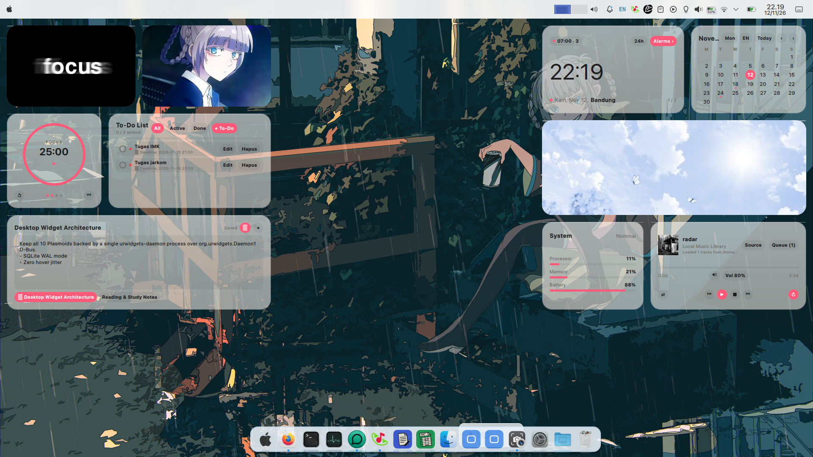

# Urdocks

<p align="center">
  <strong>Modern Liquid Glass X11 Application Dock for Linux — Built with Rust &amp; Tauri Performance</strong>
</p>

<p align="center">
  <a href="https://github.com/Harisgitama/Urdocks/releases/tag/v3.0.1">
    
  </a>
  
  
  <a href="https://github.com/Harisgitama">
    
  </a>
</p>

---

## 📸 Preview Screenshot



---

## ✨ Deskripsi & Fitur Utama

**Urdocks** adalah aplikasi dock Linux X11 bergaya macOS modern yang dirancang dengan performa tinggi berbasis **Rust & Tauri**, rendering **32-bit ARGB Cairo/XRender**, serta integrasi penuh dengan protokol **EWMH / NetWM**.

- **💎 Tema Liquid Glass & Frosted Glass Slider**: Preset tema *Liquid Glass* yang membuat tampilan dock menjadi *clear refractive glass* bening dengan kontrol slider **Frosted Glass (0%–100%)** secara *real-time*.
- **🫧 Apple Superellipse (Squircle) Capsule Tooltip**: Geometri tooltip menggunakan kurva kontinu *superellipse* (*squircle*) khas Apple sehingga transisi dari garis lurus ke lengkungan ujung terlihat sangat halus dan tidak patah.
- **🔒 Single-Instance Guard**: Mengunci proses menggunakan kernel `fcntl.flock` dan X11 Selection Owner sehingga walaupun aplikasi diklik berkali-kali, hanya tetap ada **1 instance dock** yang berjalan.
- **🪟 Smart Window Focus, Minimize & Single-App Restore**:
  - **Klik Aplikasi Terbuka & Aktif**: Otomatis melakukan *minimize* dengan efek *shrink* bawaan Linux menuju ikon aplikasi tersebut di dock (`_NET_WM_ICON_GEOMETRY`).
  - **Klik Aplikasi di Background (Saat Membuka ≥ 2 Aplikasi)**: Langsung memindahkan jendela aplikasi yang berada di belakang ke **paling atas (aktif)** tanpa me-*minimize* terlebih dahulu.
  - **Restore Satu Aplikasi Saat Semua Di-Minimize**: Ketika semua aplikasi sedang di-*minimize*, mengklik salah satu ikon di dock hanya akan me-*maximize*/*restore* aplikasi yang diklik tersebut saja.
- **🎨 Load Icon Preset dari KDE Plasma & Sistem Linux**: Memuat tema ikon dan logo secara langsung dari `~/.local/share/plasma/desktoptheme/` (`.svg` & `.svgz`) serta `/usr/share/icons`.
- **🌐 Dukungan Ikon Web-to-Native (`pake.run` / Tauri)**: Membaca metadata `.desktop` (`Icon=`, `StartupWMClass=`, `Exec=`, `Path=`) dan mencocokkan `/proc/<pid>/exe` sehingga ikon aplikasi hasil konversi web-ke-native seperti **pake.run** tampil akurat.
- **📌 Auto-Dock Aplikasi Aktif & Pin di Dock**: Setiap aplikasi yang baru dibuka otomatis masuk ke dock (`_NET_CLIENT_LIST`), dilengkapi menu klik kanan dengan checkbox **`[✓] Pin di Dock`** serta fitur **Smooth Autohide** saat kursor berada di luar area dock.
- **🌈 Sinkronisasi Warna Aksen Linux Aktif**: Mengikuti warna aksen sistem Linux yang sedang aktif secara otomatis (Linux Mint/Cinnamon, GNOME, KDE Plasma, MATE, XFCE).

---

## 📦 Cara Instalasi

### Opsi 1: Download Langsung File `.deb` (Rekomendasi)

Unduh paket installer `.deb` resmi melalui halaman GitHub Releases:

👉 **[Download Urdocks Release v3.0.1 (.deb)](https://github.com/Harisgitama/Urdocks/releases/tag/v3.0.1)**

Atau unduh dan instal langsung lewat terminal:

```bash
wget https://github.com/Harisgitama/Urdocks/releases/download/v3.0.1/urdocks_v3.1.0.deb
sudo dpkg -i urdocks_v3.1.0.deb || sudo apt-get install -f -y
